# Lunar Rhythm & Intentional Blocks

A Google Calendar system that replaces clock-time with the two celestial rhythms the body already
tracks: the daily path of the sun (seven colour-coded blocks keyed to the ISNA prayer times for
Manhattan) and the lunar months (Hijri anchors counting down to Ramadan and to Dhul-Hijjah).
Built from the three uploaded briefs (the dictated request, the Gemini "master prompt", and the
Gemini Apps Script draft) and populated directly into Google Calendar.

| Item | Where |
|---|---|
| Calendar | Google Calendar → **Lunar Rhythm & Intentional Blocks** (3,116 events, 2026-10-11 → 2027-06-05) |
| 40-prayer tracker | Google Sheet → [🕌 40-Prayer Habit Tracker & Streak Engine](SHEET_URL_PLACEHOLDER) |
| Full timetable | [`build/timetable.md`](build/timetable.md) (monthly tables) · [`build/timetable.csv`](build/timetable.csv) · [`build/timetable.json`](build/timetable.json) |
| Verification | [`build/validation_report.md`](build/validation_report.md) |
| Portable copy | [`build/ics/`](build/ics/) — one `.ics` per month plus `LRIB_ALL.ics` |
| Engine | [`timetable_engine.py`](timetable_engine.py) + raw data in [`data/aladhan_raw/`](data/aladhan_raw/) |
| Optional automation | [`LunarRhythm.gs`](LunarRhythm.gs) (Google Apps Script) |

Location 40.7610 N, −73.9590 W (E 61st St & York Ave) · Method ISNA (Fajr 15°, Isha 15°, Maghrib = sunset,
Asr standard) · Time zone America/New_York with DST applied · Hijri dates: Saudi High Judiciary Council
(Aladhan HJCoSA), cross-checked against Umm al-Qura.

---

## 1. The day

```mermaid
gantt
    title Lunar Rhythm day structure (Sun 11 Oct 2026, 30 Rabi al-Thani 1448, ISNA Manhattan)
    dateFormat HH:mm
    axisFormat %H:%M
    section Night
    B0 Pre-Dawn Tahajjud (Fajr-45m to Fajr)        :b0, 05:03, 05:48
    section Dawn
    B1 Dawn / First Light (Fajr to Sunrise-10m)    :b1, 05:48, 06:53
    Buffer 1 horizon passing, leave blank          :crit, buf1, 06:53, 07:18
    section Day
    B2 High Dopamine Core Work (to Dhuhr)          :active, b2, 07:18, 12:43
    B3 Core Wrap-Up (Dhuhr to Asr)                 :b3, 12:43, 15:52
    B4 Afternoon and Sunset Prep (Asr to Maghrib-15m) :b4, 15:52, 18:07
    Buffer 2 hard stop, leave blank                :crit, buf2, 18:07, 18:22
    section Evening
    B5 Evening Reset (Maghrib to Isha)             :b5, 18:22, 19:37
    B6 Wind Down to Sleep (Isha to midnight)       :b6, 19:37, 23:59
```


<details><summary>Mermaid source (validated gantt)</summary>


</details>

Every block shifts by the minute, every day, with the real prayer times. The two buffers are deliberately
**empty**: no event, no work, no prayer.

| Block | Window | Colour (Google colorId) | Theme | Alerts |
|---|---|---|---|---|
| 🌌 **B0** Pre-Dawn (Tahajjud) | Fajr − 45 min → Fajr | Grape (3) | stillness, du'a, optional night prayer | at block start |
| 🌅 **B1** Dawn / First Light | Fajr → Sunrise − 10 min | Peacock / turquoise (7) | Fajr at the earliest time, adhkar, mental ramp | Fajr prayer event fires at the adhan; a countdown notice fires 10 min before the hard stop |
| — Buffer 1 | Sunrise − 10 → Sunrise + 15 | *(blank)* | horizon passing; nothing scheduled | — |
| ☀️ **B2** High Dopamine Core Work | Sunrise + 15 min → Dhuhr | Banana / light yellow (5) | warm 10 AM sun; majority of core work; **no sleeping** | 35 min before (= B1 countdown) and 10 min before |
| 🟧 **B3** Core Wrap-Up | Dhuhr → Asr | Tangerine / dark orange (6) | pray Dhuhr first, then taper and close loops | 10 min before |
| 🌇 **B4** Afternoon & Sunset Prep | Asr → Maghrib − 15 min | Tomato / red (11) | pray Asr, outdoors, errands, weather | 10 min before |
| — Buffer 2 | Maghrib − 15 → Maghrib | *(blank)* | hard stop on all activity | — |
| 🔵 **B5** Evening Reset | Maghrib → Isha | Blueberry / deep blue (9) | Maghrib at the earliest time, supper, home, swim | 25 min before (= B4 countdown) |
| ⚫ **B6** Wind Down to Sleep | Isha → 12:00 AM | Graphite (8) | Isha and Witr, full wind-down, sleep | 10 min before |
| 🕌 **Prayer tick-offs** (×5) | adhan, 25-min marker | Basil / green (10) | `[ ] 🕌 Fajr · by 06:53` → edit to `[x]` when prayed | at the adhan |
| 🌙 **Daily Hijri header** | all-day | Lavender (1) | `30 Rabi' al-Thani 1448 · 🌑 · Ramadan −120d` | — |
| 🌙 **1st-of-month anchor** | all-day | Sage (2) | associative meaning of the month + executive anchor | — |
| ✨ **Milestones** | all-day | Flamingo (4) | Isra & Mi'raj, mid-Sha'ban, Qadr nights, Arafah, both Eids, Tashreeq, cycle end | — |

Every block description carries the Hijri date, the moon phase, the countdowns, the exact window, the
theme, the **Rule of 3** template, and the hand-off to the next block:

```
🛑 RULE OF 3: PRE-BLOCK INTENTIONS 🛑
Before beginning this block, define exactly what you will do:
1. [ ] Task: _________________ (Est Time: ___ mins)
2. [ ] Task: _________________ (Est Time: ___ mins)
3. [ ] Task: _________________ (Est Time: ___ mins)
```

Google Calendar alerts can only be set relative to a block's **start**, so the "time left" countdowns at the
end of B1 and B4 are implemented as early alerts on the following block (B2 at −35 min lands exactly
10 min before B1's hard stop; B5 at −25 min lands 10 min before B4's hard stop).

## 2. The month

Eight anchors fall inside the range. Each anchor's description carries the progression line, the
associative meaning (etymology of the month's name plus the classical "sowing → irrigating → harvesting"
image for Rajab → Sha'ban → Ramadan) and one executive anchor sentence.

| 1st of … | Gregorian | Theme |
|---|---|---|
| Jumada al-Ula 1448 | Mon 2026-10-12 | Solidification & Crystallization |
| Jumada al-Akhirah 1448 | Wed 2026-11-11 | Clearing the Decks |
| Rajab 1448 (sacred) | Thu 2026-12-10 | The Sacred Sowing |
| Sha'ban 1448 | Sat 2027-01-09 | Irrigation & Athletic Conditioning |
| **Ramadan 1448** | **Mon 2027-02-08** | The Furnace & the Harvest — peak milestone 1 |
| Shawwal 1448 (Eid al-Fitr) | Tue 2027-03-09 | Elevation & Carrying the Gains |
| Dhul-Qi'dah 1448 (sacred) | Thu 2027-04-08 | The Sacred Encampment |
| **Dhul-Hijjah 1448** (sacred) | **Fri 2027-05-07** | The Summit — peak milestone 2 (Arafah Sat 05-15, Eid al-Adha Sun 05-16) |

The cycle ends on 30 Dhul-Hijjah 1448 = Sat 2027-06-05 (1 Muharram 1449 is 2027-06-06).
Every day also carries an all-day header such as `🌙 14 Jumada al-Ula 1448 · 🌔 · Ramadan −84d`, so the
lunar position and the countdown are the first thing visible on any day.

## 3. The 40-prayer loop

1. Each prayer has a green `[ ] 🕌 … · by HH:MM` event at the adhan with the on-time window in its description.
   The window closes at the block's hard stop (Fajr → sunrise − 10, Dhuhr → Asr, Asr → Maghrib − 15,
   Maghrib → Isha, Isha → midnight).
2. When you pray inside the window, edit the title to `[x] 🕌 …` (phone or desktop), then mark **On-Time** in
   the tracker sheet. **Late** = after the window closed. **Missed** = not prayed.
3. The sheet's Streak column is one running formula: each On-Time adds 1, any Late or Missed resets to 0,
   history is never deleted. The KPI row shows current streak, record streak, totals, on-time rate and
   progress to 40.
4. Optional automation (`LunarRhythm.gs`, see §6): an hourly Apps Script reads your `[x]` ticks from the calendar
   and writes On-Time / Late / Missed into the sheet for you, and adds the dropdown and colours.

## 4. Accuracy and verification

- **Source of timings**: Aladhan API, ISNA method (id 2), lat/long above, ISO-8601 with offsets, stored raw
  in `data/aladhan_raw/`. The API itself reported `timezone: America/New_York`, `Fajr 15 / Isha 15`,
  `school STANDARD` for every month.
- **Independent cross-check 1**: a local port of the PrayTimes algorithm (same parameters) recomputed every
  prayer for all 238 days. Largest disagreement: 1 minute (rounding), Dhuhr identical on all days.
- **Independent cross-check 2**: `hijridate` (Umm al-Qura) agreed with Aladhan's Hijri date on all 238 days.
- **Structural checks**: every block ends after it starts; no block spans the DST changes (2026-11-01 and
  2027-03-14); the moon is within a few days of new on each Hijri 1st.
- Full detail: `build/validation_report.md`.

Known limits, stated plainly:

- Hijri month starts follow the Saudi calculated calendar. If a local sighting announcement differs,
  the affected month shifts by one day; only the all-day header / anchor / milestone events would move.
- Asr uses the standard (Shafi'i) shadow factor, which is ISNA's default. Hanafi Asr would be later.
- "Midnight" for B6 and the Isha window is 12:00 AM by design (your brief), not the Islamic mid-night.
- Times are rounded to the minute, as every published timetable is.

## 5. Re-generating or extending

```bash
python3 -m venv .venv && .venv/bin/pip install hijridate icalendar
# refresh raw data (one file per month):
curl -sS "https://api.aladhan.com/v1/calendar/2027/7?latitude=40.7610&longitude=-73.9590&method=2&iso8601=true" -o data/aladhan_raw/2027-7.json
# edit START / END in timetable_engine.py, then:
.venv/bin/python -I timetable_engine.py --sheet-url "<tracker sheet url>" --calendar-id "<calendar id>"
```

The engine rewrites `build/` (timetable, ICS, tracker CSV and `payloads/batch_NN.json`, the exact
Google Calendar API `create_event` bodies used to populate the calendar). Every event carries an
`LRIB-ID: <date>-<kind>` line in its description so re-runs can be reconciled without duplicates.

## 6. Optional Google Apps Script (`LunarRhythm.gs`)

Only needed for the automatic tick-off sync or to extend past June 2027 from inside Google.

1. script.google.com → New project → paste `LunarRhythm.gs`, set `CONFIG.SHEET_URL`.
2. Project Settings → show `appsscript.json` → `"timeZone": "America/New_York"`.
3. Run `setupTrackerSheet` once (dropdown, colours, frozen header), then `installHourlyTrigger`.
4. `extendCalendar("2027-06-06", "2027-07-05")` adds the same blocks for a later range (skips days
   that already have LRIB events). `deleteLRIBEvents(from, to)` removes them.

## 7. Portable `.ics` fallback

If the calendar ever needs to be rebuilt elsewhere: Google Calendar → Settings → Import & export →
import `build/ics/LRIB_<month>.ics` into the target calendar (one file per month keeps each import under
Google's size limit). Google ignores per-event colours in `.ics` files, which is why the live calendar
was populated through the API instead.

## 8. Files

```
lunar-rhythm-calendar/
├── README.md                     this file
├── timetable_engine.py           data → validation → events → outputs
├── LunarRhythm.gs                optional Apps Script automation
├── data/aladhan_raw/*.json       Aladhan monthly calendars (ISNA, ISO-8601), Oct 2026 – Jun 2027
└── build/
    ├── timetable.{json,csv,md}   the full timetable
    ├── validation_report.md      cross-check results
    ├── day_structure.svg         rendered day diagram
    ├── prayer_log.csv            the tracker sheet's source
    ├── ics/                      LRIB_ALL.ics + LRIB_<YYYY-MM>.ics
    └── payloads/                 create_event bodies in 12 batches (+ index.json)
```

Tip: the older fixed-time **"Time Blocks "** calendar overlaps this one; untick it in the Google Calendar
sidebar while the Lunar Rhythm calendar is active.
